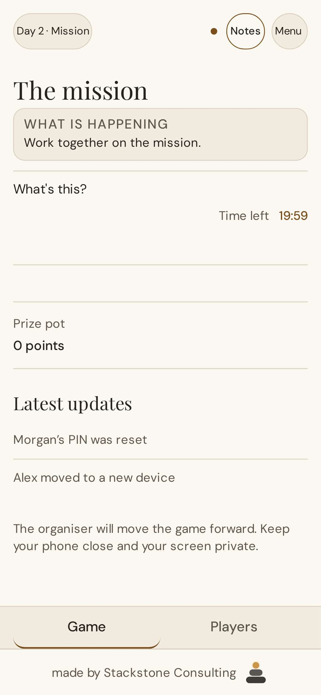
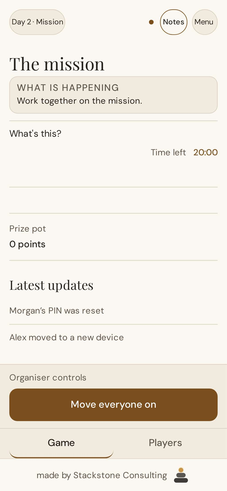

# Missions review (read-only, 26 October 2026)

Scope: trace what missions actually do today, check whether the owner's
37-row CSV (`attached_assets/missions-review_1792389710747.csv`) is used,
judge each mission for a real indoor mixed-age group of about 15, and list
what is missing end to end. No mission behaviour was changed.

## Bottom line

**Missions do not exist in the game yet.** A real game has a MISSION phase
every round, but it shows only "Work together on the mission", a 20-minute
timer and "Prize pot 0 points". There is no mission content, no way to record
a result, nothing ever adds to the pot and nobody can allocate shields. The
CSV is not wired in anywhere. Practice mode switches missions off, which is
why the owner has never seen them.

For a Halloween launch this week, the safe option is to switch missions off
for new games and show a dismissible "Missions are coming" notice (Option A
below). Building even a minimal mission feature is two to three days of work
plus testing and is not the right risk this week.

## What players see today (390 px)

| Player                                                                   | Organiser                                                                      |
| ------------------------------------------------------------------------ | ------------------------------------------------------------------------------ |
|  |  |

With "What's this?" open:
[player](screens/missions-review/mission-player-help-390.jpg),
[organiser](screens/missions-review/mission-organiser-help-390.jpg). The help
text promises "Your organiser records the result and any prize earned", but
the organiser's only control is "Move everyone on".

## The real flow, traced

- **New games keep missions on.** `artifacts/party-game/src/new-game-config.ts`
  sets no mission options, so the schema defaults in
  `lib/shared/src/config.ts` apply: `missions.enabled: true`,
  `shields: 'secret'`, `allocation: 'random'`, pot unit "points". The default
  schedule format is "day", which gives MISSION 20 minutes each round
  (`lib/engine/src/decide.ts`, `duration`).
- **Practice mode turns them off.** The rehearsal game built in
  `artifacts/api-server/src/app.ts` sets `missions: { enabled: false,
shields: 'off' }`.
- **The phase is empty.** `lib/engine/src/decide.ts` enters MISSION at the
  start of each round when missions are enabled, then moves to DEBATE on the
  organiser's "Move everyone on" or when the timer ends. No command or event
  carries a mission, a result or a pot change.
- **The pot never moves.** `pot` starts at 0 in `lib/engine/src/reducer.ts`
  and no event changes it. Players and the presenter screen still display it.
- **Shields are unreachable.** The engine protects a shielded player from a
  night murder (`decide.ts`, the `protected` outcome), and `AllocatePower`
  exists. It is organiser-only, and with the default `shields: 'secret'` the
  organiser is refused, so in practice no one can ever hold a shield.
- **"Tasks" are a different feature.** `TaskDefinition` and
  `SubmitTaskReport` are secret Traitor tasks, off by default with an empty
  catalogue. They are not group missions.
- **The CSV is not used.** None of its 37 ids or titles appear in any source
  file, and there is no mission schema to load it into.

## Is the CSV any good?

It reads as a sensible list of general party games, but it was written as a
party-games list rather than for a hidden-traitor game, and that is the main
problem. In this kind of game a mission earns its place by doing three
things: building a shared reward, taking 10 minutes or less with little
preparation, and giving a Traitor a quiet way to sabotage it, so that the
result feeds the next discussion ("why did you put the spoon down?"). None
of the 37 rows mentions sabotage or suspicion. Individual contests (musical
statues, straight face) add fun but nothing to the deduction.

Data issues to fix before importing anything:

- Categories are inconsistent: `target-toss` is "outdoor" but listed for
  indoor use; office missions are marked remote-friendly.
- `maxPot` varies (50, 75, 80, 100, 120, 150) without a clear reason, and
  several scoring rules depend on the organiser's judgement ("near match").
- Some need space a home does not have (`potato-relay` needs 10 metres) or
  carry safety risks (`taste-detective` involves food and blindfolds:
  allergies).
- Four missions are age 14 or 16 and office-only, so they are unsuitable for
  mixed ages.

## Mission-by-mission verdict

Judged for about 15 people indoors, ages roughly 6 to adult, Halloween. "Sabotage"
means a Traitor can quietly make the group fail in a way that creates
suspicion.

| Mission          | Verdict           | Why                                                                       |
| ---------------- | ----------------- | ------------------------------------------------------------------------- |
| blind-build      | Keep              | Strong sabotage (describer misleads); prep is two matching sets per team. |
| straight-face    | Drop              | Individual; no sabotage or shared result.                                 |
| charades-relay   | Adapt             | Good sabotage (bad acting); cut to 10 minutes and ship a title list.      |
| spoon-pass       | Keep              | Simple kit, everyone plays, a deliberate drop is suspicious.              |
| memory-tray      | Keep              | Whole group, ages 5+, sabotage by "remembering" wrong items.              |
| hum-that-tune    | Adapt             | Fun; teams compete against each other rather than for a shared pot.       |
| one-word-story   | Keep (filler)     | No prep; a Traitor can derail the story. Scoring needs a clear rule.      |
| taste-detective  | Drop              | Food and allergy risk; individual.                                        |
| silent-line-up   | Keep              | Best fit: no prep, everyone, ages 8+, one misplaced person sinks it.      |
| truth-hunt       | Drop              | Age 16; office ice-breaker.                                               |
| pitch-it         | Drop              | Age 14; office.                                                           |
| paperclip-chain  | Drop              | Office supplies; weak at home.                                            |
| desk-hunt        | Drop              | Office-only.                                                              |
| target-toss      | Keep              | Socks and buckets; a missed throw can be deliberate.                      |
| scavenger-hunt   | Keep              | Works indoors; light prep.                                                |
| potato-relay     | Drop              | Needs 10 metres of clear floor.                                           |
| sound-guess      | Optional          | Gentle and seated; little sabotage.                                       |
| feel-the-bag     | Optional          | Individual; little sabotage.                                              |
| word-chain       | Keep (filler)     | No prep; stalling is sabotage.                                            |
| twenty-questions | Keep              | No prep; bad questions are sabotage.                                      |
| fetch-it         | Drop              | Individual race around the house.                                         |
| zoom-in          | Drop              | Remote-only; needs prepared photos.                                       |
| quickfire-quiz   | Optional          | Needs ten prepared questions.                                             |
| animal-parade    | Optional (kids)   | Individual; fine for young children.                                      |
| treasure-trail   | Keep (kids)       | Teams, light prep, young children love it.                                |
| musical-statues  | Drop              | Individual elimination; nothing shared.                                   |
| wrap-race        | Hold (Christmas)  | Good team mission for December.                                           |
| carol-scramble   | Hold (Christmas)  | Needs prepared sheets.                                                    |
| christmas-list   | Hold (Christmas)  | No prep; good.                                                            |
| paper-chain      | Hold (Christmas)  | Craft prep; fine.                                                         |
| mummy-wrap       | Keep (Halloween)  | Funny, cheap, everyone involved.                                          |
| pumpkin-roll     | Adapt (Halloween) | Use an orange and a short course indoors.                                 |
| mystery-cauldron | Keep (Halloween)  | Great atmosphere; pot 50 is out of line; individual.                      |
| mask-makers      | Optional          | 15 minutes of craft; better for children's parties.                       |
| night-sounds     | Keep (filler)     | No prep beyond slips; ages 5+.                                            |
| spooky-spelling  | Keep (Halloween)  | Team, simple.                                                             |
| haunted-whispers | Keep (Halloween)  | Excellent: a Traitor can change the message on purpose.                   |

Roughly 12 strong keeps, 8 adapt/optional, 4 held for Christmas and 13 drops.
The quantity is fine; a game of 4 to 6 rounds needs about 6 good missions per
season. What is missing is the Traitor angle, a small kit list, and a shared
result.

## End-to-end gaps

1. No mission content model (title, how to play, kit, time, ages, space,
   season, pot value) and no loader for the CSV.
2. No choice of mission: neither the organiser picking one nor a random draw
   filtered by age, space and season.
3. Players see no instructions during MISSION.
4. No way to record success or failure, so the pot never changes, and no
   engine event for it.
5. Shields default to "secret, random" but nothing allocates them; the
   protection in the night is unreachable.
6. The pot's purpose at the end of the game is undecided (a real prize,
   bragging rights, or something that changes the result).
7. An empty 20-minute phase every round adds dead time unless the organiser
   skips it.
8. Practice mode never shows missions, so no one rehearses them.
9. No test plays a mission end to end; PLAN notes pot validation as pending.

## Options

- **A. Missions off for now, with a notice (recommended for this week).** New
  games set `missions: { enabled: false, shields: 'off' }`; the game screen
  shows a short "Missions are coming" notice that players can hide on their
  own device. This removes the empty phase and the "0 points" pot. It is a
  small, test-first change.
- **B. Halloween-lite missions (2 to 3 days, risky this week).** Show one
  curated mission card to everyone in MISSION; the organiser taps
  "succeeded" or "failed" and the pot changes. No shields. This needs a
  content model, an engine event, organiser and player screens, and new
  scenario tests.
- **C. Full missions for Christmas.** About 8 to 10 sabotage-friendly
  missions per season, chosen by age, space and season; a shared pot with a
  decided purpose; shields earned through missions; and a kit list sent to
  the organiser in the Lobby.

## Owner decisions needed

1. Approve Option A for the Halloween launch.
2. For Christmas: what the pot is for, and whether shields stay in the game.
